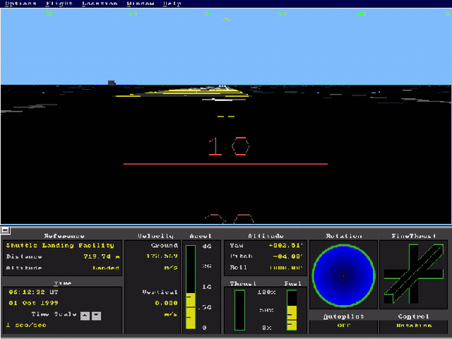
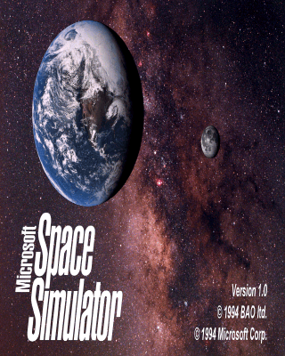
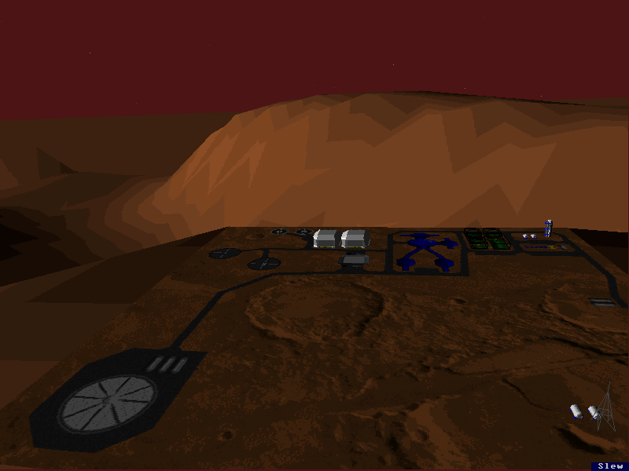
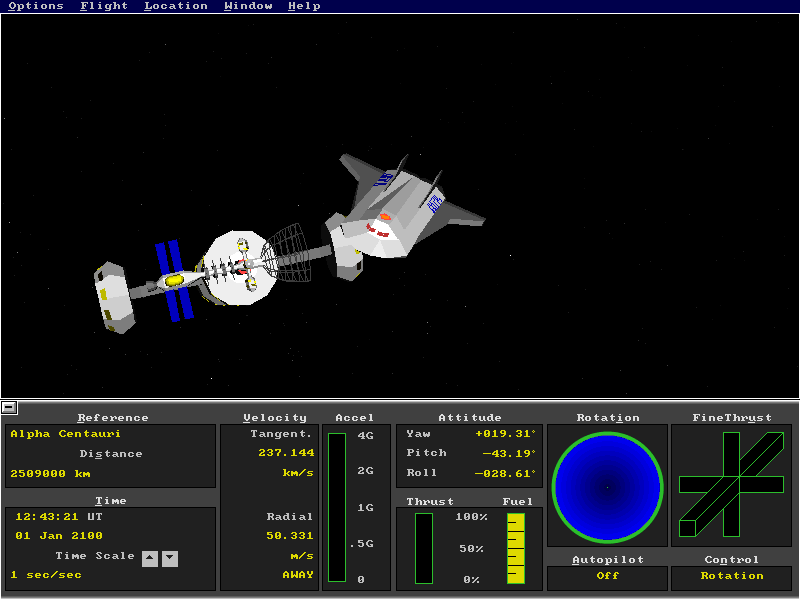
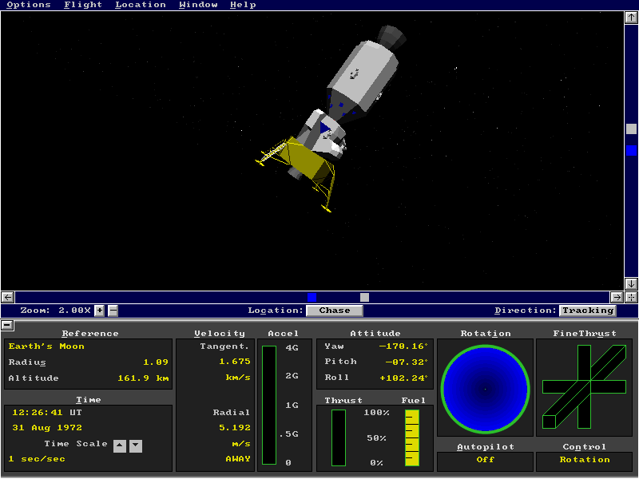
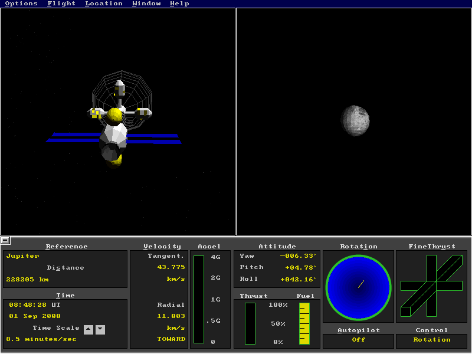
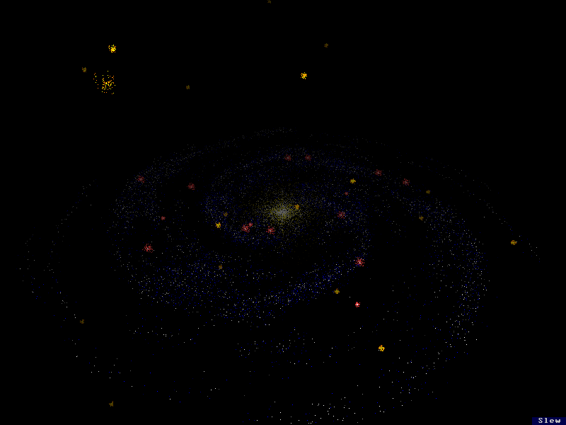

# Microsoft Space Simulator, recompiled

A static recompilation of **Microsoft Space Simulator** (1994, Bruce Artwick
Organization / Microsoft Home) from its DOS executable to a native Windows
program. The game's 16-bit real-mode code, most of it hand-written 386
assembly, is translated to C by [pcrecomp](https://github.com/sp00nznet/pcrecomp)
and runs on a small DOS machine in `src/`. No DOSBox, no emulator. You supply
the three floppy images; nothing from the game is in this repository.

Part of the [pcrecomp](https://github.com/sp00nznet/pcrecomp) family, built in
its shared house style (the same pipeline, flags, headless recording and
harness as the other recomp repos).

## Status

**v0.1.0-dev, pre-alpha.** It boots to the simulator and the simulation runs.

| | |
|---|---|
| Install from the floppies | the 21 data generators the 1994 installer ran (MAKEDATA, MAKEHMO, S01–S19DATA) are recompiled too, and build the 543 star, planet and sky files |
| Microsoft Home logo, title screen | ✅ |
| Simulator: view window, star field, instrument panel, mission clock | ✅ renders and runs (seen headless) |
| Expanded memory (EMS 4.0) | ✅ the game's 40 pages, bank switching |
| Menus, dialogs, keyboard | ✅ menus, the Location dialogs (deep sky, stars, planets, comets, surface), Open Situation, Arrange Windows; scripted keys in headless runs |
| 3D models, planets, surfaces | ✅ stations, spacecraft, Mars terrain, the Milky Way (every shipped situation runs headless) |
| Keyboard, Xbox controller | ✅ arrows for attitude, keypad +/- for thrust; the pad is mapped to the same keys |
| Mouse in play | not yet verified |
| Music and sound effects | ✅ the game runs under `SS1.EXE` as it did on DOS, and SS1's own AdLib player (lifted too) plays the music, or the engine sounds |
| Super VGA 640×400 and 800×600 | ✅ 800×600 by default: the driver files are lifted as variants of the driver region, over a VESA 1.2 model |
| Lift | 1,157 functions, 58,299 instructions, 3 code segments |

On top of the original, as in the
[Gunman](https://github.com/sp00nznet/gunman),
[SimCity 2000](https://github.com/sp00nznet/simcity2000) and
[Theme Park](https://github.com/sp00nznet/themepark-recomp) recomps:

| | |
|---|---|
| Direct3D 11 presenter | sharp-bilinear (crisp at any size), smooth, CRT, nearest and integer scaling; vivid colour; resizable; borderless fullscreen |
| Settings menu (F11) | save states, window size, scaling, speed, mute, screenshot; kept in `settings.ini` beside the exe |
| Save states | 9 slots, the whole machine; a state loads where it was saved (in flight, from flight) |
| Speed control | the game's clock at 0.5x, 1x, 2x or 4x real time (on top of its own time rate) |
| Headless recording | `--headless --record out.mp4`: video and audio, deterministic, no window |

It has been played headless and in a window on a virtual monitor; treat it as
pre-alpha.

## Screenshots



| | |
|---|---|
|  |  |
|  |  |
|  |  |

All made headless (`--headless --shot-at`, `--record`) at 800x600; see
[`tools/screens.py`](tools/screens.py).

## Getting Started

You need your own copy: the three 1.44 MB floppy images (`Microsoft Space
Simulator 1.IMA` … `3.IMA`), loose or in the zip they often come in.

### Quick start

1. Download this repository (Code → Download ZIP) and unpack it anywhere.
2. Put the floppy images (or their zip) in its `original` folder.
3. Double-click **`Setup.cmd`**.

Setup checks for Python 3, CMake, Git and the Visual Studio 2022 C++ build
tools and offers to install whatever is missing (it says what, why and how big
first). It finds the images in `original\`, the repository folder or your
Downloads, or asks. Then it runs the steps below and leaves
**`Microsoft Space Simulator.lnk`** in the folder. Building takes a few
minutes. If anything fails it stops with one sentence saying what to do, and
the details are in `setup.log`; running it again carries on from there.

### Step by step

Prerequisites: Windows 10/11; Visual Studio 2022 with "Desktop development
with C++" (or the Build Tools); CMake 3.20+; Git; Python 3.10+ with
`pip install capstone`. Use `py -3` -- a bare `python` can be the Microsoft
Store alias, which only opens the Store. Open a new terminal after installing
anything, so PATH is current.

1. The toolkit, at the commit this needs (its changes are open pull requests):
   ```
   git clone https://github.com/sp00nznet/pcrecomp work\pcrecomp
   git -C work\pcrecomp checkout 357136a
   ```
2. Unpack the floppy images (or their zip) into `game\`:
   ```
   py -3 tools\unpack_floppies.py original game
   ```
   `375 files unpacked to game` -- each archive member's CRC is checked.
3. Lift the game and the 21 install tools to C (`work\*\gen`, never committed):
   ```
   py -3 tools\lift.py all
   ```
   The first line should read `SPACESIM.EXE: ... 3 code segments, 1157 functions`
   or close to it. `SS1.EXE`, the launcher with the music player, is lifted
   too and linked into `spacesim.exe`.
4. Build:
   ```
   cmake -B build -G "Visual Studio 17 2022" -A x64
   cmake --build build --config Release -- -m
   ```
5. Generate the star systems, as the installer did:
   ```
   py -3 tools\generate.py
   ```
   It runs the recompiled MAKEDATA, MAKEHMO and S01–S19DATA and ends with
   `star systems generated`. S10DATA is skipped, exactly as the original
   `FINISH.BAT`'s typo (`s10ata`) skipped it; `--s10data` adds that system.
6. Write the settings the 1994 SETUP program wrote:
   ```
   py -3 tools\make_ini.py
   ```
   and a two-line `game\SETUP.INI` (your name, then a product ID). Defaults:
   800x600, music on, starting in the `FLIGHT` situation; `--sound effects`,
   `--sound off`, `--situation NAME` and `--driver vga.drv` change them.
7. Play the scripted inputs in `tools\exercise\` headless, lifting and
   rebuilding until no new code turns up:
   ```
   py -3 tools\converge.py
   ```
   Some user-interface code is only named by pointers in data, so the lifter
   finds it when a run reaches it (`work\spacesim\misses.txt`, never
   committed). The runs include every shipped situation. Each pass prints how
   many new routines it found; it stops at 0.
8. Run `build\Release\spacesim.exe`.

## Usage

| Key | |
|---|---|
| F11 | settings menu: save / load state, window size, scaling, speed, vivid colour, fullscreen, mute, screenshot |
| F12 | next scaling mode (sharp, smooth, CRT, nearest, integer) |
| Shift+F12 | screenshot to `screenshots\` |
| Alt+Enter | fullscreen |
| click in the picture | the mouse is the game's; Alt+Tab or F11 frees it |

The game uses F1–F10 and the rest of the keyboard as it always did (arrows for
yaw and pitch, keypad + and – for thrust, F1/F2 for the time rate, Alt for the
menus).

Xbox controller: left stick or d-pad = arrows, RT / LT = thrust up / down,
RB / LB = F1 / F2, A = Enter, B or Start = Esc, X = Space, Back = Tab.

```
spacesim [options]
  --headless          no window, no audio device; deterministic time
  --record out.mp4    video + audio through ffmpeg
  --shot-at MS:FILE   frames at emulated times, e.g. 20000:title.bmp
  --seconds N         stop after N seconds of emulated time
  --keys MS:KEY,...   scripted input (SAVEn / LOADn for save states)
  --display MODE      scaling: sharp, smooth, crt, nearest, integer
  --fullscreen        start fullscreen
  --no-ss1            run SPACESIM.EXE without its launcher (no music)
  --trace             DOS calls to stderr
```

The full list is at the top of [`src/main.c`](src/main.c).

## Building from source

Steps 3 and 4 above, or on a [recomp-netlab](https://github.com/sp00nznet/recomp-netlab)
farm: `netlab check msspacesim` (recipe `projects/msspacesim.env`) builds with
clang-cl into `build-farm/` and runs `selftest.exe` on a test VM. The lifter and its decisions are described in
[docs/lifting.md](docs/lifting.md); the parts and how they fit in
[docs/architecture.md](docs/architecture.md).

## License

MIT, see [LICENSE](LICENSE); third-party code is listed in [NOTICE](NOTICE).
That covers this repository's own code only. Microsoft Space Simulator is
Microsoft's; the lifted C is generated on your machine from your copy and is
never distributed.
